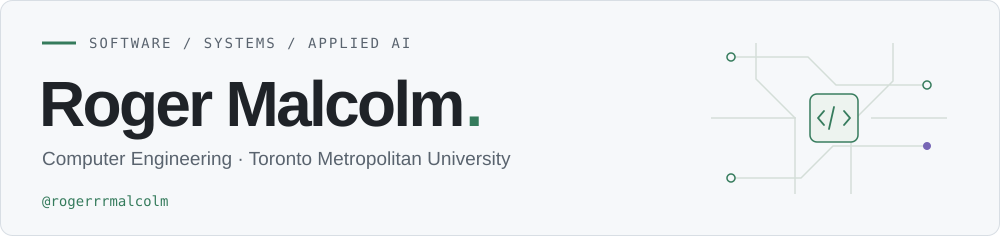

<picture>
  <source media="(prefers-color-scheme: dark)" srcset="assets/header-dark.svg">
  <source media="(prefers-color-scheme: light)" srcset="assets/header-light.svg">
  
</picture>

 

I’m a Computer Engineering student at **Toronto Metropolitan University**. I work on backend systems, applied AI, and software that interacts with the physical world.

At **TMU Wave**, I develop control and telemetry software for autonomous underwater vehicles.

[LinkedIn](https://www.linkedin.com/in/rogermalcolm/) &nbsp;·&nbsp; [Email](mailto:malcolmroger219@gmail.com) &nbsp;·&nbsp; [Repositories](https://github.com/rogerrrmalcolm?tab=repositories)

## Contributions

<picture>
  <source media="(prefers-color-scheme: dark)" srcset="https://raw.githubusercontent.com/rogerrrmalcolm/rogerrrmalcolm/output/github-contribution-grid-snake-dark.svg">
  <source media="(prefers-color-scheme: light)" srcset="https://raw.githubusercontent.com/rogerrrmalcolm/rogerrrmalcolm/output/github-contribution-grid-snake.svg">
  
</picture>

## Selected work

**[Spatial Physics Engine](https://github.com/rogerrrmalcolm/Energy-Conversion-Simulator)**  
Kerr spacetime and Penrose energy extraction, simulated across 25,000+ parameter states. AVX2 SIMD optimization improved throughput by 3.37×.  
C++20 · Python · Graph search · SIMD

**[Heart Rate Monitor](https://github.com/varenr/HeartRateMonitor)**  
ESP32 firmware with real-time signal visualization in Python. A first-place project combining embedded systems and signal processing.  
C++20 · ESP32 · UART · PySerial · Matplotlib

**[Agentic Diligence Platform](https://github.com/rogerrrmalcolm/Bastion)**  
A four-agent M&A research system for financial, market, regulatory, and risk analysis, with document retrieval and Redis-backed state.  
Python · LangGraph · FastAPI · RAG · PostgreSQL · Redis

## Experience

| Team | Work | When |
| :--- | :--- | :--- |
| **TMU Wave** | Software Developer · Autonomous Vehicles | Mar 2026 – Present |
| **Toronto Metropolitan University** | Research Assistant | Jun – Aug 2026 |
| **Next Stop Toronto** | Software Engineering Intern | May – Jul 2026 |
| **AfroLink** | Software Engineering Intern | Mar – May 2026 |

## Tools I use

<picture>
  <source media="(prefers-color-scheme: dark)" srcset="https://skillicons.dev/icons?i=cpp%2Cpython%2Cjs%2Creact%2Cpostgres%2Caws%2Cdocker%2Clinux&amp;theme=dark">
  <source media="(prefers-color-scheme: light)" srcset="https://skillicons.dev/icons?i=cpp%2Cpython%2Cjs%2Creact%2Cpostgres%2Caws%2Cdocker%2Clinux&amp;theme=light">
  
</picture>

  

**Also:** C, Java, Go, SQL, Bash · PyTorch, PySpark, Supabase · Kubernetes, Terraform, GitHub Actions

---

Outside of engineering: **guitar**, **basketball**, and **weightlifting**.
