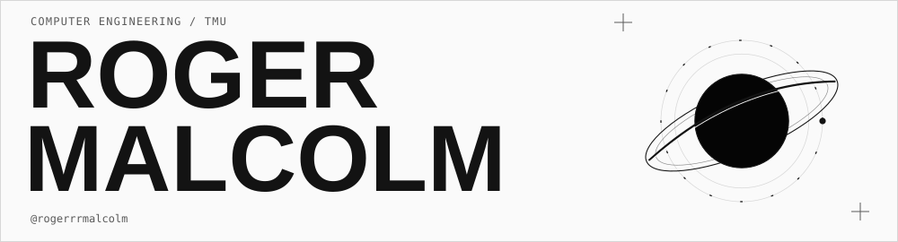
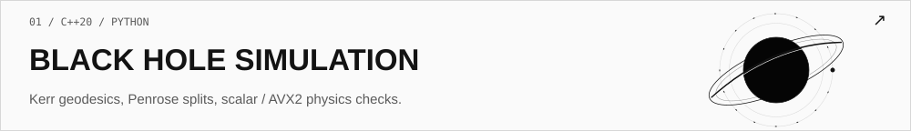
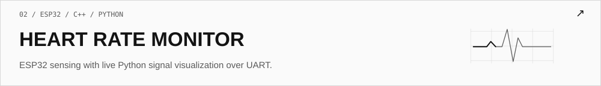
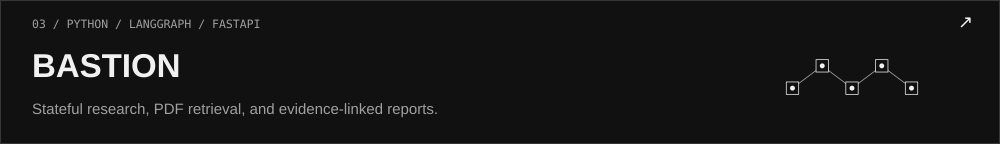
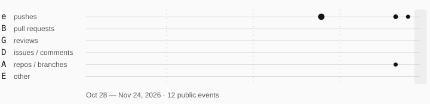

<picture>
  <source media="(prefers-reduced-motion: reduce) and (max-width: 600px) and (prefers-color-scheme: dark)" srcset="https://raw.githubusercontent.com/rogerrrmalcolm/rogerrrmalcolm/output/profile-hero-dark-mobile-still.svg">
  <source media="(prefers-reduced-motion: reduce) and (max-width: 600px) and (prefers-color-scheme: light)" srcset="https://raw.githubusercontent.com/rogerrrmalcolm/rogerrrmalcolm/output/profile-hero-light-mobile-still.svg">
  <source media="(prefers-reduced-motion: reduce) and (prefers-color-scheme: dark)" srcset="https://raw.githubusercontent.com/rogerrrmalcolm/rogerrrmalcolm/output/profile-hero-dark-still.svg">
  <source media="(prefers-reduced-motion: reduce) and (prefers-color-scheme: light)" srcset="https://raw.githubusercontent.com/rogerrrmalcolm/rogerrrmalcolm/output/profile-hero-light-still.svg">
  <source media="(max-width: 600px) and (prefers-color-scheme: dark)" srcset="https://raw.githubusercontent.com/rogerrrmalcolm/rogerrrmalcolm/output/profile-hero-dark-mobile.svg">
  <source media="(max-width: 600px) and (prefers-color-scheme: light)" srcset="https://raw.githubusercontent.com/rogerrrmalcolm/rogerrrmalcolm/output/profile-hero-light-mobile.svg">
  <source media="(prefers-color-scheme: dark)" srcset="https://raw.githubusercontent.com/rogerrrmalcolm/rogerrrmalcolm/output/profile-hero-dark.svg">
  <source media="(prefers-color-scheme: light)" srcset="https://raw.githubusercontent.com/rogerrrmalcolm/rogerrrmalcolm/output/profile-hero-light.svg">
  
</picture>

I study Computer Engineering at **Toronto Metropolitan University** and write control and telemetry software for **TMU Wave’s autonomous underwater vehicles**.

[LinkedIn](https://www.linkedin.com/in/rogermalcolm/) · [Email](mailto:malcolmroger219@gmail.com) · [All repositories](https://github.com/rogerrrmalcolm?tab=repositories)

## Selected work

<a href="https://github.com/rogerrrmalcolm/Energy-Conversion-Simulator">
<picture>
  <source media="(prefers-reduced-motion: reduce) and (max-width: 600px) and (prefers-color-scheme: dark)" srcset="https://raw.githubusercontent.com/rogerrrmalcolm/rogerrrmalcolm/output/project-physics-dark-mobile-still.svg">
  <source media="(prefers-reduced-motion: reduce) and (max-width: 600px) and (prefers-color-scheme: light)" srcset="https://raw.githubusercontent.com/rogerrrmalcolm/rogerrrmalcolm/output/project-physics-light-mobile-still.svg">
  <source media="(prefers-reduced-motion: reduce) and (prefers-color-scheme: dark)" srcset="https://raw.githubusercontent.com/rogerrrmalcolm/rogerrrmalcolm/output/project-physics-dark-still.svg">
  <source media="(prefers-reduced-motion: reduce) and (prefers-color-scheme: light)" srcset="https://raw.githubusercontent.com/rogerrrmalcolm/rogerrrmalcolm/output/project-physics-light-still.svg">
  <source media="(max-width: 600px) and (prefers-color-scheme: dark)" srcset="https://raw.githubusercontent.com/rogerrrmalcolm/rogerrrmalcolm/output/project-physics-dark-mobile.svg">
  <source media="(max-width: 600px) and (prefers-color-scheme: light)" srcset="https://raw.githubusercontent.com/rogerrrmalcolm/rogerrrmalcolm/output/project-physics-light-mobile.svg">
  <source media="(prefers-color-scheme: dark)" srcset="https://raw.githubusercontent.com/rogerrrmalcolm/rogerrrmalcolm/output/project-physics-dark.svg">
  <source media="(prefers-color-scheme: light)" srcset="https://raw.githubusercontent.com/rogerrrmalcolm/rogerrrmalcolm/output/project-physics-light.svg">
  
</picture>
</a>

<a href="https://github.com/varenr/HeartRateMonitor">
<picture>
  <source media="(prefers-reduced-motion: reduce) and (max-width: 600px) and (prefers-color-scheme: dark)" srcset="https://raw.githubusercontent.com/rogerrrmalcolm/rogerrrmalcolm/output/project-heart-dark-mobile-still.svg">
  <source media="(prefers-reduced-motion: reduce) and (max-width: 600px) and (prefers-color-scheme: light)" srcset="https://raw.githubusercontent.com/rogerrrmalcolm/rogerrrmalcolm/output/project-heart-light-mobile-still.svg">
  <source media="(prefers-reduced-motion: reduce) and (prefers-color-scheme: dark)" srcset="https://raw.githubusercontent.com/rogerrrmalcolm/rogerrrmalcolm/output/project-heart-dark-still.svg">
  <source media="(prefers-reduced-motion: reduce) and (prefers-color-scheme: light)" srcset="https://raw.githubusercontent.com/rogerrrmalcolm/rogerrrmalcolm/output/project-heart-light-still.svg">
  <source media="(max-width: 600px) and (prefers-color-scheme: dark)" srcset="https://raw.githubusercontent.com/rogerrrmalcolm/rogerrrmalcolm/output/project-heart-dark-mobile.svg">
  <source media="(max-width: 600px) and (prefers-color-scheme: light)" srcset="https://raw.githubusercontent.com/rogerrrmalcolm/rogerrrmalcolm/output/project-heart-light-mobile.svg">
  <source media="(prefers-color-scheme: dark)" srcset="https://raw.githubusercontent.com/rogerrrmalcolm/rogerrrmalcolm/output/project-heart-dark.svg">
  <source media="(prefers-color-scheme: light)" srcset="https://raw.githubusercontent.com/rogerrrmalcolm/rogerrrmalcolm/output/project-heart-light.svg">
  
</picture>
</a>

<a href="https://github.com/rogerrrmalcolm/Bastion">
<picture>
  <source media="(prefers-reduced-motion: reduce) and (max-width: 600px) and (prefers-color-scheme: dark)" srcset="https://raw.githubusercontent.com/rogerrrmalcolm/rogerrrmalcolm/output/project-bastion-dark-mobile-still.svg">
  <source media="(prefers-reduced-motion: reduce) and (max-width: 600px) and (prefers-color-scheme: light)" srcset="https://raw.githubusercontent.com/rogerrrmalcolm/rogerrrmalcolm/output/project-bastion-light-mobile-still.svg">
  <source media="(prefers-reduced-motion: reduce) and (prefers-color-scheme: dark)" srcset="https://raw.githubusercontent.com/rogerrrmalcolm/rogerrrmalcolm/output/project-bastion-dark-still.svg">
  <source media="(prefers-reduced-motion: reduce) and (prefers-color-scheme: light)" srcset="https://raw.githubusercontent.com/rogerrrmalcolm/rogerrrmalcolm/output/project-bastion-light-still.svg">
  <source media="(max-width: 600px) and (prefers-color-scheme: dark)" srcset="https://raw.githubusercontent.com/rogerrrmalcolm/rogerrrmalcolm/output/project-bastion-dark-mobile.svg">
  <source media="(max-width: 600px) and (prefers-color-scheme: light)" srcset="https://raw.githubusercontent.com/rogerrrmalcolm/rogerrrmalcolm/output/project-bastion-light-mobile.svg">
  <source media="(prefers-color-scheme: dark)" srcset="https://raw.githubusercontent.com/rogerrrmalcolm/rogerrrmalcolm/output/project-bastion-dark.svg">
  <source media="(prefers-color-scheme: light)" srcset="https://raw.githubusercontent.com/rogerrrmalcolm/rogerrrmalcolm/output/project-bastion-light.svg">
  
</picture>
</a>

A few engineering details

- **Black holes:** The same physics checks run against the scalar and AVX2 implementations. [Model and benchmarks](https://github.com/rogerrrmalcolm/Energy-Conversion-Simulator#performance-engineering).
- **Heart monitor:** C++ on the ESP32; PySerial and Matplotlib on the receiving end.
- **Bastion:** Model-backed analysis is separate from deterministic research and report assembly. [Architecture](https://github.com/rogerrrmalcolm/Bastion#system-architecture).

Experience and tools

| Team | Work | When |
| :--- | :--- | :--- |
| TMU Wave | Software Developer · Autonomous Vehicles | Mar 2026 – Present |
| Toronto Metropolitan University | Research Assistant | Jun – Aug 2026 |
| Next Stop Toronto | Software Engineering Intern | May – Jul 2026 |
| AfroLink | Software Engineering Intern | Mar – May 2026 |

Most of my work uses C++, Python, SQL, and Linux. I also work with React, FastAPI, PostgreSQL, Redis, Docker, and AWS.

Live activity

**Four weeks on six strings**

<picture>
  <source media="(max-width: 600px) and (prefers-color-scheme: dark)" srcset="https://raw.githubusercontent.com/rogerrrmalcolm/rogerrrmalcolm/output/activity-tab-dark-mobile.svg">
  <source media="(max-width: 600px) and (prefers-color-scheme: light)" srcset="https://raw.githubusercontent.com/rogerrrmalcolm/rogerrrmalcolm/output/activity-tab-light-mobile.svg">
  <source media="(prefers-color-scheme: dark)" srcset="https://raw.githubusercontent.com/rogerrrmalcolm/rogerrrmalcolm/output/activity-tab-dark.svg">
  <source media="(prefers-color-scheme: light)" srcset="https://raw.githubusercontent.com/rogerrrmalcolm/rogerrrmalcolm/output/activity-tab-light.svg">
  
</picture>

Each dot groups one day’s public GitHub events. Bigger dots mean more events; a push can contain several commits. The view refreshes daily and follows the last 28 UTC days available from GitHub’s public feed.

| String | Activity |
| :--- | :--- |
| e | Pushes |
| B | Pull requests |
| G | Reviews |
| D | Issues and comments |
| A | Repositories and branches |
| E | Other public events |

[Generator](scripts/build_activity_tab.py) · [Activity data](https://github.com/rogerrrmalcolm/rogerrrmalcolm/blob/output/activity.json) · [Refresh workflow](https://github.com/rogerrrmalcolm/rogerrrmalcolm/actions/workflows/snake.yml)

Contribution snake

<picture>
  <source media="(prefers-color-scheme: dark)" srcset="https://raw.githubusercontent.com/rogerrrmalcolm/rogerrrmalcolm/output/github-contribution-grid-snake-dark.svg">
  <source media="(prefers-color-scheme: light)" srcset="https://raw.githubusercontent.com/rogerrrmalcolm/rogerrrmalcolm/output/github-contribution-grid-snake.svg">
  
</picture>

I’m also into **guitar**, **basketball**, and **weightlifting**.
